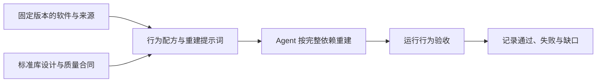

# Recipkg 标准库

**从开源软件提取可复用的配方，记录行为，也记录尚未验证的部分。**

[Recipkg](https://github.com/recipkg/recipkg) · [配方格式](https://github.com/recipkg/recipkg/blob/main/docs/SPEC.md) · [黑盒验证](https://github.com/recipkg/standard-library-verification)

本仓库按软件类别整理配方和覆盖状态。每个配方在独立仓库维护，保存软件行为、接口、依赖、验收条件和已知缺口，供 Agent 根据配方重建；本目录不是包注册表，也不是完整配方的替代品。

找到适合的条目后，先读其 `RECIPE.md` 和 `COVERAGE.md`，再按固定提交声明依赖。打包会收集递归材料；软件是否可重建，仍需运行实际验收。

## 配方目录

| 分类 | Recipkg 配方 | 固定上游来源 | 阶段 |
| --- | --- | --- | --- |
| 命令行 / 多媒体 | [ffmpeg](https://github.com/recipkg/ffmpeg) | [FFmpeg 9.0.2](https://github.com/FFmpeg/FFmpeg/tree/n9.0.2) | [提取中](https://github.com/recipkg/ffmpeg/blob/main/COVERAGE.md) |
| 命令行 / JSON 处理 | [jq](https://github.com/recipkg/jq) | [jq 1.8.2](https://github.com/jqlang/jq/tree/34f7186b86743a083a589741b6cea95293524108) | [提取中](https://github.com/recipkg/jq/blob/main/COVERAGE.md) |
| 命令行 / 文本搜索 | [ripgrep](https://github.com/recipkg/ripgrep) | [ripgrep 15.2.0](https://github.com/BurntSushi/ripgrep/tree/e89fff89ac9af12e8d4ce9d5fd07beb408ca730f) | [提取中](https://github.com/recipkg/ripgrep/blob/main/COVERAGE.md) |
| 基础能力 / 正则引擎 | [regex](https://github.com/recipkg/regex) | [rust-lang/regex 1.13.0](https://github.com/rust-lang/regex/tree/926af2e68eca3ce089815790541cf50759ba2c59) | [提取中](https://github.com/recipkg/regex/blob/main/COVERAGE.md) |
| 数据与存储 / 键值服务 | [valkey](https://github.com/recipkg/valkey) | [Valkey 9.1.2 指定源码提交](https://github.com/valkey-io/valkey/tree/7f1dffedff6de73058b2c2a389422b6ecd56c8fb) | [提取中](https://github.com/recipkg/valkey/blob/main/COVERAGE.md) |
| 数据与存储 / 关系数据库 | [postgresql](https://github.com/recipkg/postgresql) | [PostgreSQL 18.6](https://github.com/postgres/postgres/tree/724edf9bde9d356724ad384a2e196edc3c9f80f7) | [提取中](https://github.com/recipkg/postgresql/blob/main/COVERAGE.md) |
| 监控与可观测性 / 指标采集与时序存储 | [prometheus](https://github.com/recipkg/prometheus) | [Prometheus v3.15.1](https://github.com/prometheus/prometheus/tree/bae3eced0a5369e050e83ea73bc381d7c4b1a719) | [提取中](https://github.com/recipkg/prometheus/blob/main/COVERAGE.md) |
| 监控与可观测性 / 仪表盘与告警 | [grafana](https://github.com/recipkg/grafana) | [Grafana OSS v13.3.0](https://github.com/grafana/grafana/tree/752e3462ff71a43a5c1fb62d00a482fa2dc0ee6a) | [提取中](https://github.com/recipkg/grafana/blob/main/COVERAGE.md) |
| 通讯与社交 | [zulip](https://github.com/recipkg/zulip) | [Zulip 指定源码提交](https://github.com/zulip/zulip/tree/dd5adc2de6c43bd7bac7d1a0e6dc18c9364268a7) | [提取中](https://github.com/recipkg/zulip/blob/main/COVERAGE.md) |
| 内容与知识 | [miniflux](https://github.com/recipkg/miniflux) | [Miniflux 指定源码提交](https://github.com/miniflux/v2/tree/3945f3daa0a90040f761d79a5f62a678fe86ba4e) | [提取中](https://github.com/recipkg/miniflux/blob/main/COVERAGE.md) |
| 协作与办公 | [vikunja](https://github.com/recipkg/vikunja) | [Vikunja 指定源码提交](https://github.com/go-vikunja/vikunja/tree/e37ebc0d10db366ff111bc4bb74a696d7cfc912e) | [提取中](https://github.com/recipkg/vikunja/blob/main/COVERAGE.md) |
| 文件与媒体 | [syncthing](https://github.com/recipkg/syncthing) | [Syncthing 指定源码提交](https://github.com/syncthing/syncthing/tree/ed38528d7fba3dd6a42c9c9fc6780af432dc15d2) | [提取中](https://github.com/recipkg/syncthing/blob/main/COVERAGE.md) |
| 文件与媒体 / 照片与视频管理 | [immich](https://github.com/recipkg/immich) | [Immich v3.3.5](https://github.com/immich-app/immich/tree/8303cb117e197c700332b33b61b45314c9cc5bb4) | [提取中](https://github.com/recipkg/immich/blob/main/COVERAGE.md) |
| 家居与物联网 / 家居自动化 | [home-assistant](https://github.com/recipkg/home-assistant) | [Home Assistant Core 2026.10.4](https://github.com/home-assistant/core/tree/357cae5c598dfcd7a0ea7dc5b1facccd4ec6037b) | [提取中](https://github.com/recipkg/home-assistant/blob/main/COVERAGE.md) |
| Agent 应用 / 软件开发 | [openhands](https://github.com/recipkg/openhands) | [OpenHands Agent Canvas 指定源码提交](https://github.com/OpenHands/OpenHands/tree/17af119c331a87e881417e4afe95f83dd3c5cb2c) | [提取中](https://github.com/recipkg/openhands/blob/main/COVERAGE.md) |
| Agent 框架 / 执行引擎 | [openhands-agent-sdk](https://github.com/recipkg/openhands-agent-sdk) | [OpenHands Software Agent SDK 指定源码提交](https://github.com/OpenHands/software-agent-sdk/tree/46b1fa5cb91ada17e6ec938c7e8624a4fa19fa98) | [提取中](https://github.com/recipkg/openhands-agent-sdk/blob/main/COVERAGE.md) |
| Agent 框架 / 执行引擎 | [langgraph](https://github.com/recipkg/langgraph) | [LangGraph 1.2.18 固定源码提交](https://github.com/langchain-ai/langgraph/tree/3521f08e21a7d89c28331191374bc85c11ecb6e2) | [提取中](https://github.com/recipkg/langgraph/blob/main/COVERAGE.md) |
| Agent 工作流平台 | [dify](https://github.com/recipkg/dify) | [Dify 1.18.0 固定源码提交](https://github.com/langgenius/dify/tree/50abea97062110044f15d0e03ccecadd9ccc87ca) | [提取中](https://github.com/recipkg/dify/blob/main/COVERAGE.md) |
| 开发者工具 / Git 协作 | [gitea](https://github.com/recipkg/gitea) | [Gitea 指定源码提交](https://github.com/go-gitea/gitea/tree/02c03d69d35963e40f9662d4a793a55d78649444) | [提取中](https://github.com/recipkg/gitea/blob/main/COVERAGE.md) |
| AI 聊天 / Agent 管理 | [librechat](https://github.com/recipkg/librechat) | [LibreChat 指定源码提交](https://github.com/LibreChat-AI/LibreChat/tree/8d3da9bbb220a0a96be9330a2e1cbd385fb786d5) | [提取中](https://github.com/recipkg/librechat/blob/main/COVERAGE.md) |
| AI 工作区 / 文档检索与 Agent | [anything-llm](https://github.com/recipkg/anything-llm) | [AnythingLLM v1.19.0](https://github.com/Mintplex-Labs/anything-llm/tree/9b1fcab141000eaba9f78ed131151de04904454b) | [提取中](https://github.com/recipkg/anything-llm/blob/main/COVERAGE.md) |
| Agent 应用 / 个人助手 | [openclaw](https://github.com/recipkg/openclaw) | [OpenClaw 指定源码提交](https://github.com/openclaw/openclaw/tree/51420782b3810b4aa1230aa9621aec78f7dbbd3c) | [提取中](https://github.com/recipkg/openclaw/blob/main/COVERAGE.md) |
| 设计方法 / 质量合同 | [design-foundations](https://github.com/recipkg/design-foundations) | Apple、Microsoft、Android、IBM、GOV.UK、W3C 官方指南，详见配方来源 | [首版可用](https://github.com/recipkg/design-foundations/blob/main/ACCEPTANCE.md) |
| 设计方法 / 视觉方向 | [design-directions](https://github.com/recipkg/design-directions) | 基于产品任务、内容、平台与来源资料整理 | [首版可用](https://github.com/recipkg/design-directions/blob/main/ACCEPTANCE.md) |

阶段链接直达各仓库的覆盖记录；设计合同链接到其验收说明。“首版可用”表示材料可复用，不表示某个产品已完整重建。

配方存在或 `recipkg check` 通过，并不代表配方已完整，也不代表软件已根据配方重建。每个仓库须明确记录源码版本、许可、已观察内容、未知项、可复现验收和重建验证状态。

## 可重复对照测试

[标准库黑盒样本测试](https://github.com/recipkg/standard-library-verification)提供 regex、jq、ripgrep、FFmpeg、Valkey、Miniflux、Vikunja、Syncthing、Gitea、OpenHands Agent SDK 和 OpenClaw 的样本与可执行断言，可指定上游或重建程序路径。Valkey 使用发行版构建；OpenClaw 分别对照固定源码和不同提交的发布包，详见配方覆盖记录。测试仓库不属于配方归档；仅检查已有的少量样本，跳过、通过或归档检查都不代表软件已完整重建。每份配方的 `COVERAGE.md` 是覆盖状态依据。

## 分类扩展

目录按软件能力交叉分类；开始新项目时，先核实源码版本、许可、规模和可观察范围。星数只是发现信号，不代表完整性或质量。后续可增加网络与基础设施、安全与身份、商业与运营、教育与科研、游戏与娱乐等分类；分类不等于依赖关系。

## 编写和验证

1. 固定上游源码提交，记录版本、来源、许可及观察范围，阅读相关源码、文档与测试并实际观察可运行行为。
2. 描述用户行为、接口、数据与错误，明确尚未观察的范围；源码、二进制、脚本及钩子不进入配方归档。
3. 声明实际需要的递归配方依赖，说明每个别名的职责和验收；外部系统和第三方服务单列为运行前提。依赖版本固定，不把普通源码仓库冒充配方。
4. 将可复现验收写进 `ACCEPTANCE.md`；执行配方检查、打包和离线构建提示词检查。它们只验证材料结构和交付。
5. 在独立目录按完整配方重建并运行验收，记录测试通过、失败、未验证及依赖缺口。只有覆盖声明范围并通过相应验收后，才能标为完成。

配方归档和 Agent 技能是不同用途。项目级技能可以作为固定提交的独立 Git 子模块保留脚本等资源；Markdown 配方归档不包含 Git 元数据或实现文件。
